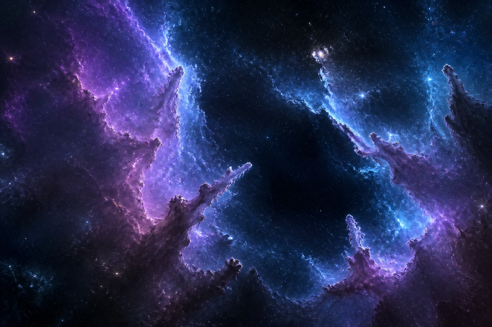
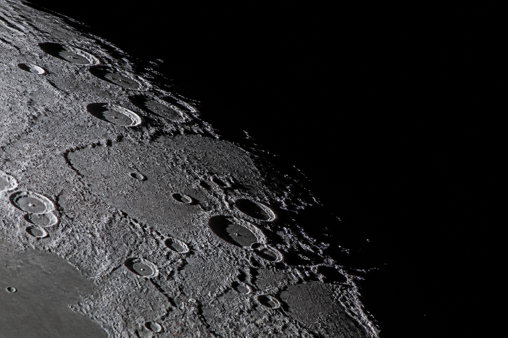

# سُها · SOHA
### Cosmic Archive / روایت بی‌کران

**جهان، قاب به قاب.** 🌌

گالری تصویری و ویدیویی نجوم با تجربه‌ای سینمایی، جست‌وجوی فارسی و فضای مدیریت اختصاصی.

---

## 🔭 آشنایی با سُها | About

**سُها (SOHA)** تجربه‌ای فارسی برای کشف تصاویر، روایت‌ها و ویدیوهای نجومی است؛ یک آرشیو بصری که میان سحابی‌ها، کهکشان‌ها، منظومه شمسی و ماه حرکت می‌کند. صفحه اصلی از تصویری شاخص آغاز می‌شود و به گالری جست‌وجوپذیر و قابل فیلتر می‌رسد.

**English:** SOHA is a Persian-first astronomy media-gallery prototype with a cinematic hero, searchable categories, a media viewer and a protected admin interface.

## ✨ What you can explore

| بخش | تجربه |
|:--|:--|
| 🌠 **نمای شاخص** | Hero تصویری با هویت بصری فضایی |
| 🔎 **جست‌وجو** | فیلتر عنوان، توضیحات و دسته‌بندی به زبان فارسی |
| 🪐 **دسته‌بندی‌ها** | سحابی‌ها، کهکشان‌ها، منظومه شمسی، ماه و ویدیوها |
| 🎞️ **مشاهده رسانه** | کارت تصویر/ویدیو و نمایش جزئیات در Modal |
| ♥️ **پسندیدن** | شمارنده لایک در داده‌های مرورگر |
| 🔒 **ورود مدیر** | `/admin/login` با اطلاعات مدیریتی سمت سرور و Cookie امضاشده |
| 🗃️ **داشبورد محتوا** | افزودن و حذف رسانه، انتشار/عدم انتشار و نمایش آمار محلی |

## 🖼️ Gallery preview

  
  

> تصاویر و اعداد اولیه در `src/data/media.ts` داده‌های نمایشی/بذر پروژه هستند. آن‌ها را **مستندات رصد واقعی، آمار بازدید حقیقی، یا تصاویر ثبت‌شده توسط یک عکاس مشخص** تلقی نکنید، مگر منشأ آن‌ها جداگانه تأیید شود.

## 🧱 Tech stack

- **Framework:** Next.js 16 (App Router), React 19, TypeScript.
- **Design:** Tailwind CSS 4, custom global styles, Lucide iconography.
- **Content state:** React hooks with `window.localStorage`.
- **Authentication:** Server-side admin credentials and HMAC-signed `HttpOnly` cookie.

~~~text
src/
├── app/
│   ├── page.tsx              # Public gallery
│   ├── admin/                # Protected editor / sign-in
│   └── api/admin/            # Login / logout handlers
├── components/               # Gallery, cards, media modal, admin UI
├── data/media.ts             # Initial demo content
├── hooks/use-media-library.ts
├── lib/admin-auth.ts         # Admin session handling
└── types/media.ts
~~~

## ⚡ Getting started

~~~bash
git clone https://github.com/MxPersonal/hamid-astronomy-x-mrhossein.git
cd hamid-astronomy-x-mrhossein
npm install
cp .env.example .env.local
npm run dev
~~~

Open `http://localhost:3000`. Before accessing the admin area, replace the example credentials with your **own strong secrets**.

| Variable | Required for admin | Purpose |
|:--|:--:|:--|
| `ADMIN_USERNAME` | ✓ | Administrator username |
| `ADMIN_PASSWORD` | ✓ | Unique password, normally at least 12 characters |
| `ADMIN_SESSION_SECRET` | ✓ | Random secret of at least 48 characters |
| `ALLOW_WEAK_ADMIN_PASSWORD` | No | Keep `false` outside isolated local tests |

**Available scripts:** `npm run dev`, `npm run build`, `npm run start`, `npm run lint`.

## ⚠️ Persistence and production limitation

The current `use-media-library` hook persists edits in **the browser's LocalStorage**, initialized from `src/data/media.ts`.

- New items and likes are **not synchronized between users, devices, or browsers**.
- Admin changes in one browser are **not a production CMS publication** for other visitors.
- Clearing site data or switching browsers can remove locally edited content.
- Media uploads are not backed by a centralized storage or database in this version.
- Counters shown from initial content are sample data, **not verified analytics**.

For a genuinely multi-user public archive, add server-side CRUD, database persistence, media storage, authorization enforcement on every write, and real analytics. Until then, treat this repository as a polished **interactive gallery prototype**.

## ☁️ Deployment

Import the GitHub repository into Vercel as a **Next.js** project; configure admin environment variables on Vercel **before** using the admin login. Pushes to the connected production branch can trigger automatic builds. Confirm page rendering and session behavior in your deployed environment; a successful build does not add shared content persistence.

## 🔐 Security notes

Never commit populated `.env.local` files. Keep admin secrets server-only (no `NEXT_PUBLIC_` prefix), use HTTPS in production, and do not treat front-end visibility toggles as database authorization.

## 📄 License & usage

No explicit LICENSE file was found in this repository at documentation time. Do **not** assume redistribution or commercial reuse rights without permission from the repository owner.

## 🛰️ From prototype to shared observatory | مسیر توسعه

This repository intentionally separates a **finished visual interaction** from a **production publishing system**.

| Capability | In this repository | Production-grade next step |
|:--|:--|:--|
| Discovery | Searchable gallery and media viewer | Cross-browser accessibility testing |
| Initial archive | Seed media in `src/data/media.ts` | Verified provenance and metadata |
| Content edits | `use-media-library` + browser LocalStorage | Authenticated server-side CRUD |
| Authentication | Protected admin session | Role-based permissions on every write |
| Counters | Demo/local values | Genuine analytics pipeline |
| Assets | Included local images and media URLs | Managed storage, moderation and backups |

### 🔭 Editorial standards

When publishing actual astrophotography, record the author, capture date, equipment, image-processing context, source and licensing permission. Keep artistic illustrations, simulations and observational photographs clearly differentiated. The seed descriptions and counts in the repository should remain labeled *demonstration content* until independently verified.

### ✅ Review before a release

~~~bash
npm run lint
npm run build
~~~

- [ ] Check the gallery and modal on mobile and desktop, including keyboard focus and dismissal.
- [ ] Search by Persian title, description and category; confirm empty-result behavior.
- [ ] Test sign-in rejection, signed-cookie expiration and logout.
- [ ] Confirm published/unpublished UI behavior and understand that local edits do **not** synchronize to other visitors.
- [ ] Do not advertise local counters as verified public viewing statistics.

**Data safety:** exporting, resetting or clearing browser data can affect locally created entries. A shared astronomical archive requires a real backend, durable media storage and documented editorial ownership.

**SOHA · Every frame opens another universe.** ✨

