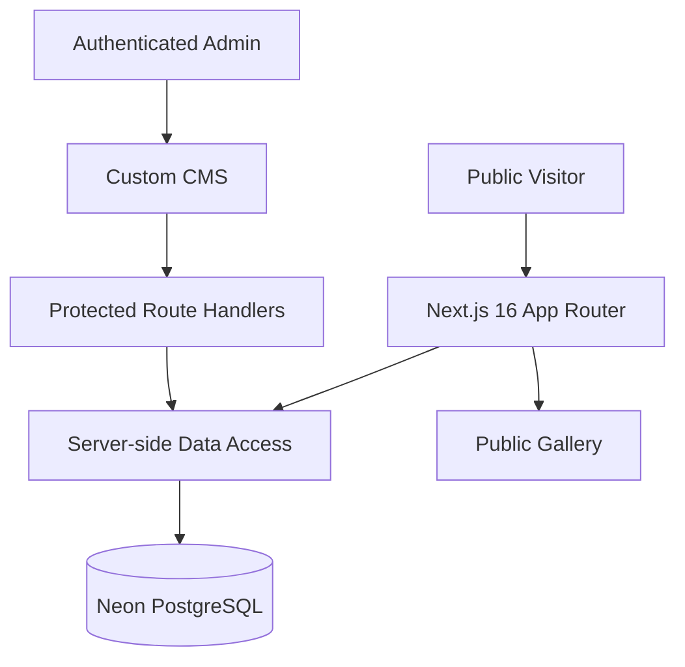

<div align="center">

# 🌌 Hamid Astronomy
### Explore the Universe, One Frame at a Time

**گالری نجومی فارسی برای تصاویر، ویدیوها و نوشته‌های مستقل علمی**

[](https://nextjs.org/)
[](https://react.dev/)
[](https://www.typescriptlang.org/)
[](https://neon.com/)
[](https://vercel.com/)

**[🌐 Live Website](https://hamid-astronomy-x-mrhossein.vercel.app/)** ·
**[🧑‍🚀 CMS Login](https://hamid-astronomy-x-mrhossein.vercel.app/admin/login)** ·
**[GitHub Repository](https://github.com/MxPersonal/hamid-astronomy-x-mrhossein)**

</div>

---

## ✨ About / درباره پروژه

**Hamid Astronomy** یک وب‌سایت گالری نجوم با طراحی **Cosmic Dark** و پشتیبانی فارسی راست‌به‌چپ است. پروژه با Next.js App Router ساخته شده و یک پنل مدیریت اختصاصی برای کنترل متن‌ها، تصاویر، ویدیوها، اطلاعات SEO و وضعیت انتشار محتوا دارد.

The website combines an editorial, responsive cosmic gallery with a custom, authenticated content management experience backed by **Neon PostgreSQL**.

## 🚀 Highlights

| Experience | Capabilities |
|---|---|
| 🌠 Public gallery | Responsive masonry-inspired layout, featured hero, category filters and search |
| 🖼️ Media viewer | Full-size image viewer, supported YouTube embeds and MP4/WebM playback |
| 💜 Engagement | Persisted like and view counters |
| 📝 Content CMS | Edit site identity, hero, headlines, descriptions, gallery, about section, footer, links and SEO fields |
| 📷 Media & text CMS | Add, edit, remove, publish/unpublish photos, videos and standalone articles |
| 🔔 Notifications | Database-backed CMS activity feed and unread status |
| 🔐 Admin security | Server-side credential validation, signed HttpOnly cookie, session expiry, same-origin checks |
| 🌙 Visual design | Matching dark-mode public site and CMS; Persian-first, RTL, mobile-responsive |
| 🗄️ Persistence | PostgreSQL tables for content, media records, and notifications |

## 🧭 Architecture



## 🧰 Tech Stack

- **Web:** Next.js 16.3, React 19, TypeScript, Tailwind CSS 4, custom CSS
- **Icons:** Lucide React
- **Typography:** Vazirmatn, RTL Persian interface
- **Database:** Neon Serverless PostgreSQL using `@neondatabase/serverless`
- **Authentication:** Environment-configured admin credentials and HMAC-signed sessions
- **Hosting:** Vercel; the `main` branch is the source for production changes

## 🗂️ Structure

```text
src/
  app/
    page.tsx                    Public entrypoint
    admin/                      Authentication and CMS
    api/admin/                  Login and logout
    api/cms/                    Protected content/media/notification APIs
    api/media/[id]/             Public engagement counters
    globals.css                 Cosmic website + CMS design system
  components/
    public-gallery.tsx          Public gallery
    media-modal.tsx             Images, video, and article reader
    admin-dashboard.tsx         CMS control panel
    site-content-editor.tsx     Site-wide text and image editing
    publish-modal.tsx           Media editor
  lib/
    cms-content.ts              Default content and editable field registry
    cms-db.ts                   Neon data access layer
    admin-auth.ts               Signed admin sessions
  data/media.ts                 Fallback/demo media for local UI
database/schema.sql             PostgreSQL schema
public/images/                  Bundled starter artwork
```

## 🛠️ Run Locally

**Requirements:** Node.js compatible with Next.js 16, npm, and optionally a Neon PostgreSQL project.

```bash
git clone https://github.com/MxPersonal/hamid-astronomy-x-mrhossein.git
cd hamid-astronomy-x-mrhossein
npm install
cp .env.example .env.local
npm run dev
```

Open `http://localhost:3000`. Set the secrets in `.env.local` before using the CMS.

### Environment Variables

| Variable | Purpose |
|---|---|
| `HAMID_ASTRONOMY_DATABASE_URL` | Preferred dedicated Neon pooled URL for this site |
| `DATABASE_URL` | Fallback pooled URL for local setups |
| `ADMIN_USERNAME` | Admin login username |
| `ADMIN_PASSWORD` | Strong admin password, at least 12 characters |
| `ADMIN_SESSION_SECRET` | Random HMAC signing secret, at least 48 characters |
| `ALLOW_WEAK_ADMIN_PASSWORD` | Optional development override. Keep `false` in production |

> 🔒 Never commit actual values, put secrets in `NEXT_PUBLIC_` variables, or expose your database URL to browsers.

### Database Setup

1. Create a separate project in [Neon](https://console.neon.tech/), or use the existing Hamid Astronomy project.
2. Run [`database/schema.sql`](database/schema.sql) in Neon's SQL Editor (idempotent schema creation).
3. Copy the pooled PostgreSQL connection string into `HAMID_ASTRONOMY_DATABASE_URL` (or `DATABASE_URL` locally).
4. Set the same environment variable securely in Vercel for your deployment.
5. Configure the three required admin credentials in Vercel and redeploy through your connected Git branch.

The existing published demo entries were imported into the initial Hamid Astronomy Neon database. On a brand-new database, add media through the CMS or import your own seed data.

**Legacy browser data:** If the previous CMS stored media in `localStorage`, sign in **using that same browser and origin**. A one-time **«انتقال رسانه قدیمی»** button appears if custom items are detected. Review the count and approve the import. Old browser data is left intact. Items that exceed upload limits must be migrated manually.

**Database tables:** `site_content` (editable text/URLs), `media_items` (gallery records and counters), `cms_notifications` (action history), `text_posts` (independent text-only posts and optional cover image).

## 🎛️ CMS Guide

Log in at `/admin/login`. The sidebar includes a media list and site-wide content editor. The top navigation includes **Back to Site**, **Notifications**, and **Logout**, also available on mobile. Choose **تصویر**, **ویدیو**, or **نوشته** under **انتشار محتوای جدید**. Text posts require a title and 10–10,000 characters of body text, accept paragraph breaks, and do not require a cover image. All content types support editing, drafts, publishing, deleting, and displaying in the public gallery. Existing items keep their type during edits. Content changes are saved immediately to Neon and visible on the public website.

### 📦 Media Storage Notes

- The CMS accepts HTTPS image URLs and small PNG/JPG/WebP uploads (currently limited to **2.5 MB** per image).
- Small file uploads are stored as encoded image data in PostgreSQL. This is convenient at low volume, but **not appropriate for a large media archive**.
- Video entries use validated YouTube embed URLs or HTTPS MP4/WebM links. Large video binary uploads are **not** stored in PostgreSQL.
- For a larger archive, migrate images and videos to **Neon Object Storage** or another object-storage provider while keeping metadata in PostgreSQL.
- The Free tiers have quotas; check [Neon pricing](https://neon.com/pricing) and [Vercel plans](https://vercel.com/pricing) before production traffic growth.

## 🔒 Security Notes

- The admin page and mutation endpoints require a valid signed session.
- Session cookies are HttpOnly and SameSite Strict; production cookies are Secure.
- Mutation endpoints reject cross-origin requests.
- The current login attempt limiter runs **per server process**, not globally. Add a shared rate limiter before high-risk public exposure.
- Likes/views are public endpoints, and the current counters are **not unique-user analytics**. Add abuse prevention if accurate metrics are essential.
- Protect and rotate `ADMIN_PASSWORD` and `ADMIN_SESSION_SECRET`.

## 🧪 Quality Commands

```bash
npm run lint
npm run build
```

Also test the following manually: public gallery, filtering, image/video/article viewer, admin login/logout, upload, publish/draft, site text edits, notification creation and read state, mobile navbar, and database persistence across browsers.

## 🤝 Contributing & Project Scope

This repository represents a custom astronomy website and CMS. Changes should maintain the **Hamid Astronomy** brand, Persian RTL accessibility, dark cosmic design, and centralized content management.

---

<div align="center">

**Made for people who look up. ✦**

**Hamid Astronomy** · Powered by curiosity, code, and the cosmos.

</div>
